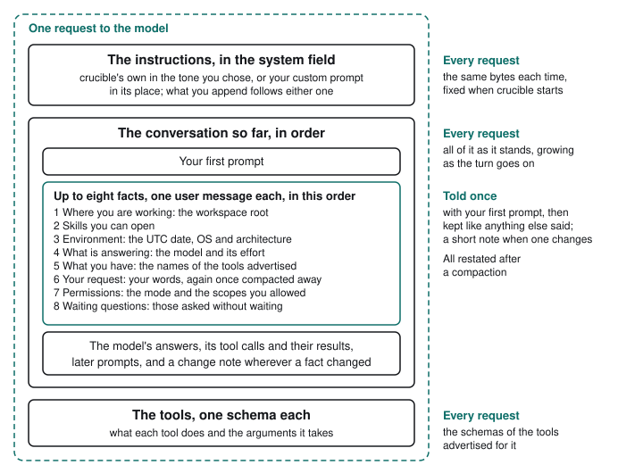

# What the model is told

<picture>
  <source media="(prefers-color-scheme: dark)" srcset="../assets/request-dark.svg">
  
</picture>

Every request that asks the model to go on with the conversation carries two
kinds of text besides it: instructions, which say how to work, and facts, which
say what is true of the session right now. They travel separately, and only the
facts that changed are sent again. The request for notes a
[compaction](sessions.md#when-the-window-fills) makes carries neither.

## Instructions

The instructions are crucible's own, in the tone you chose: how to hold a task,
read before changing and say where the work stands. Three
[`systemPrompt`](../configuration/configuration.md#systemprompt) keys shape
them: `tone` picks that tone, `append` adds to them and `custom` puts your own
in their place. They are fixed when crucible starts and go in the provider's
system field. Nothing about the session enters them, so a new model, a new tool
or the date rolling over never rewrites them.

## Facts

The facts come in up to eight sections, sent in this order:

| Section | What it says |
| --- | --- |
| Where you are working | The workspace root every tool path is relative to. |
| Skills you can open | The skills that can be opened. Crucible does not look for skills, so this says none were discovered. |
| Environment | The UTC date, the operating system and the processor architecture. |
| What is answering | The model's name and the effort it was asked at, or that the vendor's default applies. |
| What you have | The names of the tools advertised for this request. What each does travels in its own schema. |
| Your request | That what you asked for, and every instruction after it, stands until you withdraw it; once the words themselves are gone, the words again. See [Your request](#your-request). |
| Permissions | The [permission mode](../permissions/modes.md) and the scopes you allowed for the rest of this session. |
| Waiting questions | The batches the agent [asked without waiting](../tools/asking.md#asking-without-waiting) that you have not answered, each question by its heading and text. Sent only once a question has been asked that way. |

The permissions section reports; it does not authorize. It ends by saying so,
and a call is still checked by the permission engine as if the section were not
there. Your [rules](../permissions/rules.md) are not in it. Each section is
bounded: at most 64 skills and 64 allowed scopes are named, each cut to 200
characters, and the rest are counted.

Each section is sent as a user-role message of its own, not in the system
field, and stays in the conversation like anything else that was said. They
are first sent with your first prompt, so the first request reads your
question, then the sections. The sections count toward the `messages` row of
`/context`, as anything else said in the conversation does.

## Only what changed

crucible keeps what it last told the model, section by section, and compares
before every request, including each one inside a turn:

- **Nothing changed**: nothing is sent.
- **A section changed**: only that section is sent, and it says what changed:
  `## Model changed` with the new model and effort after `/model`, or
  `## What you have changed` with the tools added and removed.
- **The model has never been told**: the whole section is sent. That is every
  section at the start of a session.

The first turn of a session sends the sections once, however many tool
calls it makes, and a later turn under the same model, permissions, tools and
date sends none. Answering "Yes, and don't ask again this session"
partway through sends one short `## Permissions changed` before the next
request, and the request after that sends none. A mode change made while a turn
runs is [held for the next turn](../permissions/modes.md#stepping-it-while-you-type),
and is told to the model when that turn starts.

## After compaction

A [compaction](sessions.md#when-the-window-fills) replaces the middle of the
conversation with a recap, and the facts that were said there go with it. So
compaction removes every fact section, including any in the turns it keeps
whole, and the next request restates every one in full. A change note that
survived without the full statement it amended would leave the model knowing
only half of it.

## Your request

A compaction replaces your own words with a recap the model wrote, so what you
asked for could otherwise reach the model only as the model's summary of it.
crucible keeps your words aside for that: your first prompt in the session,
then every later prompt, every line you typed while a turn ran, and every
answer you gave to a question the agent asked without waiting. Notes crucible
writes itself, such as the one that tells the agent commands left running have
ended, are not yours and are never kept as your request. Nor is anything the
agent writes, its plan and its recaps included.

While the conversation still holds those words, the section adds no copy of
them: it says once that your request and every later instruction stand until
you withdraw them. Once a compaction has taken them, or a resumed session
cannot tell what the model was told, it restates them word for word, oldest
first. An answer is restated as an answer: the question and the answers it
offered are marked as the model's words and only your reply as yours.

What is kept is bounded:

| Part | Kept |
| --- | --- |
| Your first prompt | 16 KiB |
| Each later instruction or answer | 4 KiB |
| Later instructions and answers | the 16 most recent |

Text past a bound is cut and labelled incomplete, and instructions dropped for
the last bound are counted, so the model is told part is not shown. What is
kept is written to the session log and comes back with the session.
`/clear` starts it empty, and a subagent neither sees it nor adds to it.

## When a session is picked up

What the model was told is written to the session log as the words it was
sent, followed by a line recording the state behind them. `--continue` and
`--resume` read both back, so a resumed session carries on comparing against
what the model already knows rather than starting over. If nothing changed
while it was closed, nothing is restated. A section is sent only if it changed,
as when the date has moved on, you resume under another model or a tool was
added or removed. The tools are compared by name, so a run that builds the same
tools afresh does not tell the model about them again. The mode and any
session-long allow
[are not carried over](../permissions/modes.md#--continue-resumes-the-transcript-not-the-mode),
so the model is told when they differ from what it last heard.

The words are written before the state. If crucible stops between the two the
first time a section is told, the next request finds words it has no recorded
state for and restates that section whole, opening with a line that tells the
model it supersedes every earlier version. Your request is kept aside only in that
recorded state. A session whose log holds your words but never recorded it has
lost that copy: crucible stopped before writing it, the first turn ended before
anything was sent, or the session was saved before crucible kept your request.
Your words are still in the conversation, but when your request is next
restated the model is told it was not kept, and nothing you say afterwards is
taken for it. A change told later whose state was
never written is compared against the state recorded before it. A session
written before crucible recorded that state is told every section in full.

## Why it is split this way

A provider can reuse the start of a request it has seen before, and
[prompt caching](../providers/prompt-caching.md) depends on that start staying
the same bytes. Instructions that never change come first; facts follow in
the conversation, with the ones most likely to change mid-session last.
Changing the model adds a short note at the end rather than rewriting the top.
